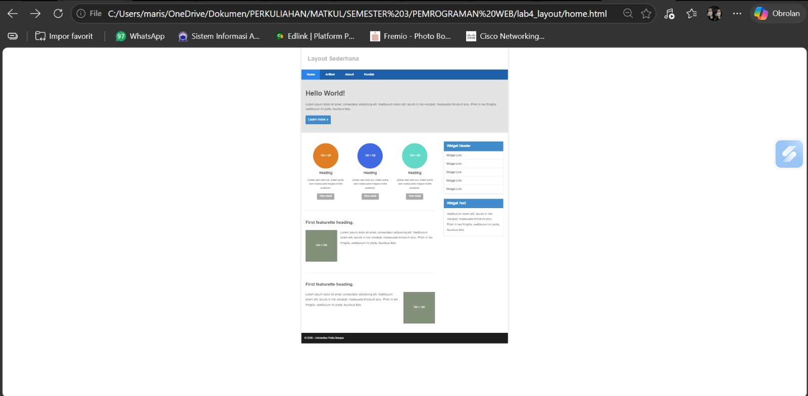
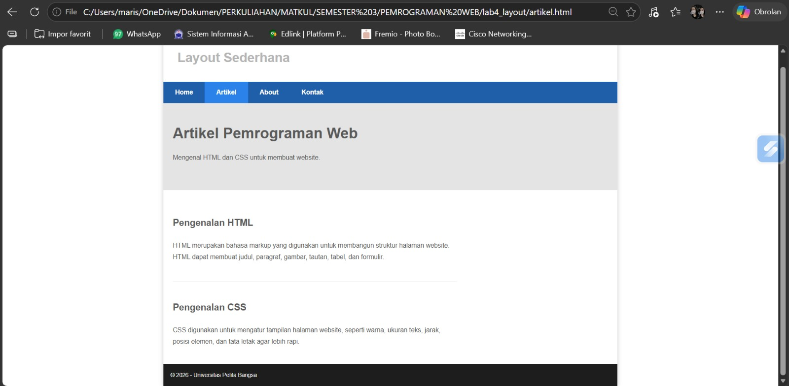
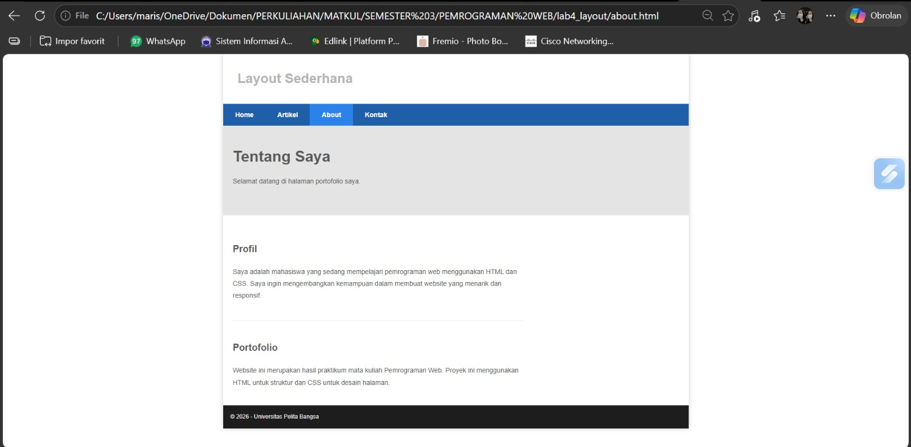
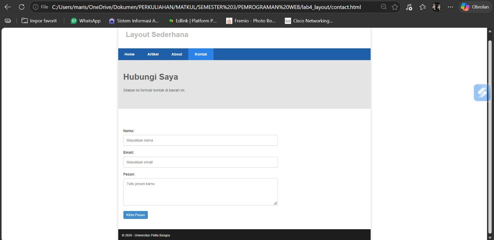
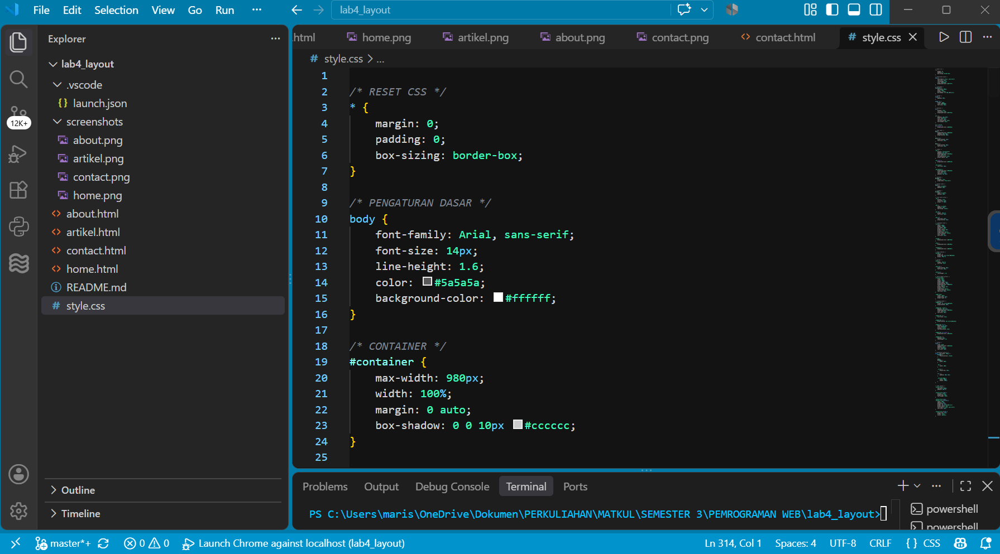

# LAPORAN PRAKTIKUM PEMROGRAMAN WEB

## Praktikum 4 — Membuat Layout Web Sederhana

### 1. Tujuan Praktikum
Mempelajari cara membuat layout website sederhana
menggunakan HTML dan CSS.

### 2. Tools yang Digunakan
- Visual Studio Code
- HTML5
- CSS3
- Google Chrome

### 3. Struktur File
- `home.html` — halaman utama
- `artikel.html` — halaman artikel
- `about.html` — halaman profil dan portofolio
- `contact.html` — halaman formulir kontak
- `style.css` — pengaturan tampilan website

### 4. Langkah-Langkah Praktikum

#### A. Membuat Layout Utama
Membuat struktur HTML yang terdiri dari header,
navigasi, hero panel, konten utama, sidebar, dan footer.

**Screenshot:**

#### B. Membuat Halaman Artikel
Membuat halaman artikel yang membahas pengenalan HTML
dan CSS.

**Screenshot:**

#### C. Membuat Halaman About
Membuat halaman yang berisi deskripsi profil
dan portofolio.

**Screenshot:**

#### D. Membuat Halaman Contact
Membuat formulir kontak yang berisi nama,
email, dan pesan.

**Screenshot:**

#### E. Mengatur Tampilan dengan CSS
Mengatur warna, ukuran teks, navigasi, tata letak,
sidebar, tombol, dan footer menggunakan CSS.

**Screenshot:**

### 5. Kesimpulan
Praktikum ini memberikan pemahaman mengenai penggunaan
HTML untuk membangun struktur halaman website dan CSS
untuk mengatur tampilan serta tata letak website.
